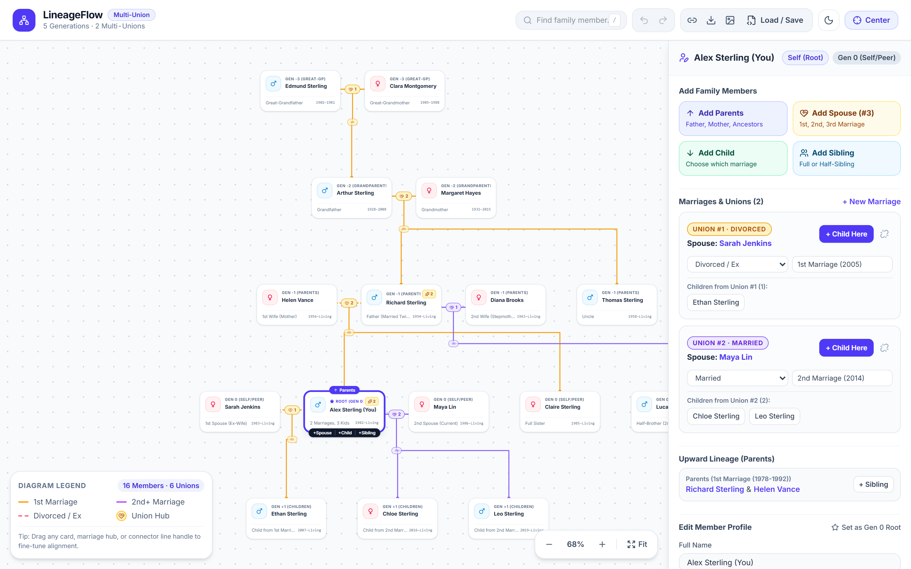
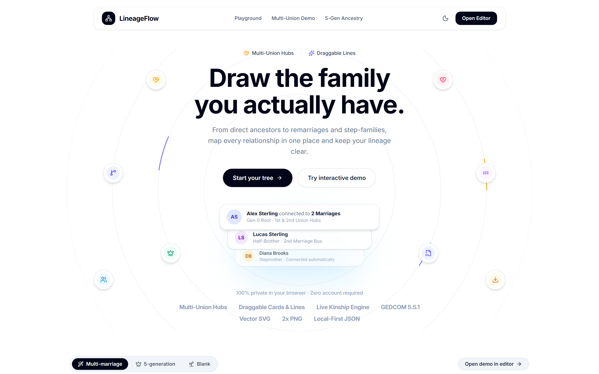

<div align="center">

# LineageFlow
### *Draw the family you actually have.*

[](LICENSE)
[](https://family-lineage-diagram-maker.vercel.app)
[](#highlights)
[](#tech)

<p align="center">
  <b>An interactive family tree maker built for multiple marriages.</b><br>
  No account, no setup. Open it and start drawing.
</p>

<p align="center">
  <a href="https://family-lineage-diagram-maker.vercel.app">
    
  </a>
</p>

```text
Add a person  ->  add a spouse, add another  ->  add children to each union  ->  done
```

---

</div>

## Demo

| Interactive Canvas & Multi-Union Editor | Minimalist Orbital Landing Page |
| :---: | :---: |
| <a href="https://family-lineage-diagram-maker.vercel.app/app?preset=multi"></a> | <a href="https://family-lineage-diagram-maker.vercel.app"></a> |
| **Canvas**: Draggable cards, union hubs, & lines | **Orbital Hero**: Concentric lineage rings & demo switcher |

---

## What is it?

Most family tree tools assume one marriage per person. Real families are messier: remarriages, half-siblings, step-parents.

**LineageFlow** models each union as its own node, so every marriage keeps its own children and the diagram stays unambiguous.

---

## Highlights

<table>
<tr>
<td width="50%">

### Multi-Union & Kinship
* A person can have any number of marriages or partners.
* Each union is color-coded: 1st marriage, 2nd+ marriage, divorced.
* Automatic kinship labels relative to the root person (*Half-Sister*, *Stepmother*, *Uncle*).

</td>
<td width="50%">

### Zero Friction
* No sign-up and no backend — 100% local in your browser.
* Import and export as **JSON** or **GEDCOM 5.5.1 (`.ged`)**.
* Export crisp **PNG** & **SVG** diagrams or share via a single URL.

</td>
</tr>
</table>

---

## Roadmap

| Status | Feature |
| :--- | :--- |
| Done | Port of the original single-file prototype to Next.js + TypeScript |
| Done | Autosave (`localStorage`), undo/redo history, dark mode |
| Done | PNG & SVG diagram export, shareable URL links, `.json` & `.ged` GEDCOM import/export |
| Done | Automatic kinship calculator & inline marriage union editor |
| Done | Mobile-ready touch pan, pinch zoom, and bottom-sheet inspector |

---

## Getting Started

```bash
git clone https://github.com/KrisnaSantosa15/LineageFlow.git
cd LineageFlow
npm install
npm run dev
```

Open [http://localhost:3000](http://localhost:3000). Run unit tests with `npm test` and browser E2E tests with `npm run test:e2e`.

---

## Tech

Next.js (App Router), TypeScript, Tailwind CSS v4, Vitest, Playwright. Ready for one-click deploy on Vercel.

The original prototype is kept in [`family_lineage_diagram_maker.html`](family_lineage_diagram_maker.html) for reference.

---

## License

This project is licensed under the [MIT License](LICENSE).
